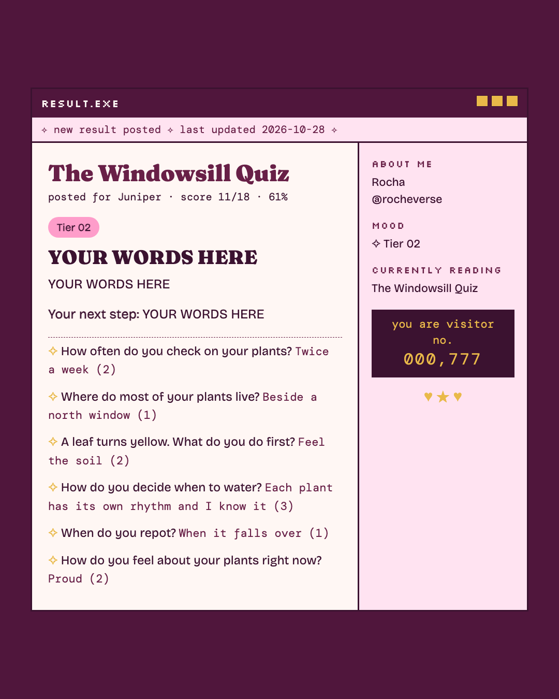
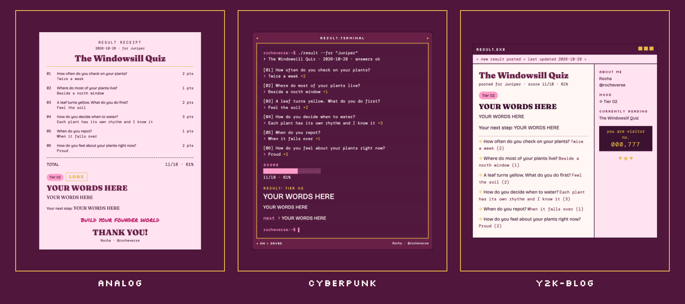

# Diagnostic Quiz

*Rocha Coded. Free tools from the Rocheverse.*

**A scored quiz with email results and lead capture, on your own accounts, in an afternoon.**

Your questions. Your results. Your list.
Someone takes your quiz, gets their result on the page and in their inbox, and their name lands in your own list.
You read your leads in a little admin page that only you can open.
Claude asks you for every word, one question at a time, and walks you through putting it online.

<p align="center"></p>

<p align="center"></p>

<p align="center"><sub>One result, three moods: analog, cyberpunk, y2k-blog. The sample is a made-up houseplant quiz. Every word is fictional, and "YOUR WORDS HERE" is where yours go.</sub></p>

## Start here
You can do this. Each step tells you what to type and what you will see when it worked.

**If you use Claude Code** (Claude in the terminal, the window where you type commands to your computer):

 Open the Terminal app. On a Mac it is in Applications > Utilities > Terminal.
   This checks that Node, the program the quiz runs on, is ready:
   ```sh
   node --version
   ```
   You will see `v22` or a higher number. If not, install the LTS version from nodejs.org and try again.

 This copies the tool onto your computer. "Clone" means download a copy from GitHub, the site where the code lives:
   ```sh
   git clone https://github.com/RochaStone/diagnostic-quiz ~/.claude/skills/diagnostic-quiz
   ```
   You will see `Cloning into...` and then the line where you type comes back.

 This opens Claude Code in your home folder:
   ```sh
   cd ~ && claude
   ```
   You will see Claude Code open and wait for you.

 Type this to Claude, in your own words if you like:
   ```
   Build me a quiz.
   ```
   You will see Claude make a folder for your quiz and ask its first question: what your quiz is called.

 When Claude says your quiz is ready to try, this runs it on your computer, from the quiz folder Claude made (`my-quiz` unless you chose another name):
   ```sh
   cd ~/my-quiz && npm run dev
   ```
   You will see `READY http://localhost:3939`. Open that address in your browser and take your own quiz.

Putting it online comes next, and Claude walks you through it one click at a time.

**If you use Claude Cowork** (the Claude desktop app): download the zip (one file that holds the whole tool),
upload it in Customize > Skills, and say "Build me a quiz." Cowork can write your quiz and show you the result.
Putting it online needs the terminal, and Claude tells you exactly what to type.

<p align="center"></p>

## What you get
- **Your quiz page.** One question at a time, a little block progress bar, and it remembers where someone was if they close the tab.
- **The result.** Their score, their tier, your words about where they are, and the one next step you want them to take. In the motif you love: an analog receipt, a cyberpunk terminal, or a y2k blog window.
- **The result email.** The same result in their inbox, built to look right in Gmail, Apple Mail and Outlook.
- **Your list.** Every name and email saved in your own database, with whether they said yes to your mailing list.
- **Your admin page.** Your leads, newest first, behind a key only you hold.
- **A link at the bottom** of every result, to your booking page or your offer, if you want one.

<p align="center"></p>

## Where it lives
Everything runs on your own free accounts. Nothing passes through anyone else's.

| What | Where | What it does |
|---|---|---|
| The quiz page | your Vercel | puts the quiz on the internet |
| Your leads | your Supabase | a private database table only your quiz can write to |
| The result emails | your Resend | sends from your own email address |

A few words you will meet:
- **Deploy** means putting your quiz online.
- **API key** is a private password a service gives you so your quiz can use it. It goes into Vercel, never into a chat.
- **Environment variable** is one of those private settings, kept in Vercel and never in the code.
- **Terminal** is the window where you type commands to your computer.

## If it goes wrong (everyone's first time) 
This happens to everyone the first time. Here are the three most common moments and the fix for each.
- **The quiz says "That was quick. Take a breath and send it again."** It waits 8 seconds from Start, to keep robots out. Wait a moment and press send again.
- **The result shows but the email never arrives.** Your lead is still saved. Open your admin page: the last column says `failed`. Most often your domain is not Verified in Resend yet, or `EMAIL_FROM` uses a different domain. Once it shows Verified, new emails go out.
- **`npm run check` names a problem.** It tells you which question or tier, in plain words. Ask Claude to fix it with you, then run it again until you see `QUIZ OK`.

<p align="center"></p>

## Make it yours
Your look lives in one file, `style.json`: your colours, fonts, your scrawl line, and your name and handle on the result.
It ships with two examples: `examples/style.rocha-coded.json` (my plum receipt) and a blank `style.example.json` for yours, explained in `STYLE.md`. Or ask Claude to make one with you from a few references.
Pick your motif, `analog`, `cyberpunk` or `y2k-blog`, to change the structure. Your palette and fonts re-tone all three, so every version is yours to curate.
The same file works across every Rocha Coded tool, so you make it once.

## Safe by design
Your quiz collects names and emails, so it was reviewed line by line. The short version:
your admin key is checked in constant time and never travels in a link, the quiz only accepts answers from your own site,
every answer is checked and size-limited, sends are rate limited, every word on the page and in the email is escaped,
and your database refuses the public entirely. The full list is in [SECURITY.md](SECURITY.md).

## What's inside
| File | What it does |
|---|---|
| `SKILL.md` | the steps Claude follows: the interview, your config, your look, the setup and the deploy |
| `quiz.config.json` | your quiz: questions, points, tiers, email words. Ships with a fictional sample |
| `lib/quiz.js` | checks the config and does the scoring (pure, no network) |
| `lib/render.js` | draws the result in all three motifs from one function, for the page and the email |
| `lib/style.js` | finds and reads `style.json` |
| `lib/store.js` | saves leads to Supabase, or to memory or a file when you run it on your computer |
| `lib/email.js` | sends through Resend, or prints the email in the terminal when you run it on your computer |
| `lib/http.js`, `lib/auth.js`, `lib/lead.js`, `lib/ratelimit.js` | the safety layer, described in `SECURITY.md` |
| `api/` | the three functions Vercel runs: the quiz, the submit, and your admin list |
| `public/` | the quiz page and the admin page |
| `supabase/migrations/` | the one table, to paste into Supabase |
| `scripts/` | run it locally, check the config, make a token, render previews, make the README images |
| `tests/` | the tests, and `tests/TESTING.md` with exactly what was run |
| `env.example` | the names of the private settings, with a note on each |

No packages to install. It runs on Node 22 and nothing else.

For the curious, run it by hand:
```sh
npm test
npm run preview -- --motif cyberpunk
```

## Licence
MIT. See [LICENSE](LICENSE). Copyright (c) 2026 Rochelle Livingstone / Thriving Era Studio.

 [Sign my guestbook](https://github.com/RochaStone/diagnostic-quiz/issues)

## Made by Rocha

Rocha \
Brand Alchemist & AI Architect \
Author of *Brand Alchemy in the Thriving Era* \
Creator of [Conscious Founder OS](https://founders.thrivingera.com) \
Founder, [Thriving Era Studio](https://thrivingera.com)

I take female founders AI native in 7 days, and I build what they need next. \
Start with the audit: [thrivingera.com/audit](https://thrivingera.com/audit). \
Or book an exploratory call: [calendly.com/rochelle-thrivingera/exploratory-call](https://calendly.com/rochelle-thrivingera/exploratory-call). It is where we decide if we work together.

[Instagram @rocheverse](https://instagram.com/rocheverse) · [Substack](https://rochastone.substack.com) · [LinkedIn](https://www.linkedin.com/in/rochellelivingstonecosmic) · [More free tools](https://thrivingera.com/free) · [All tools on GitHub](https://github.com/RochaStone)
